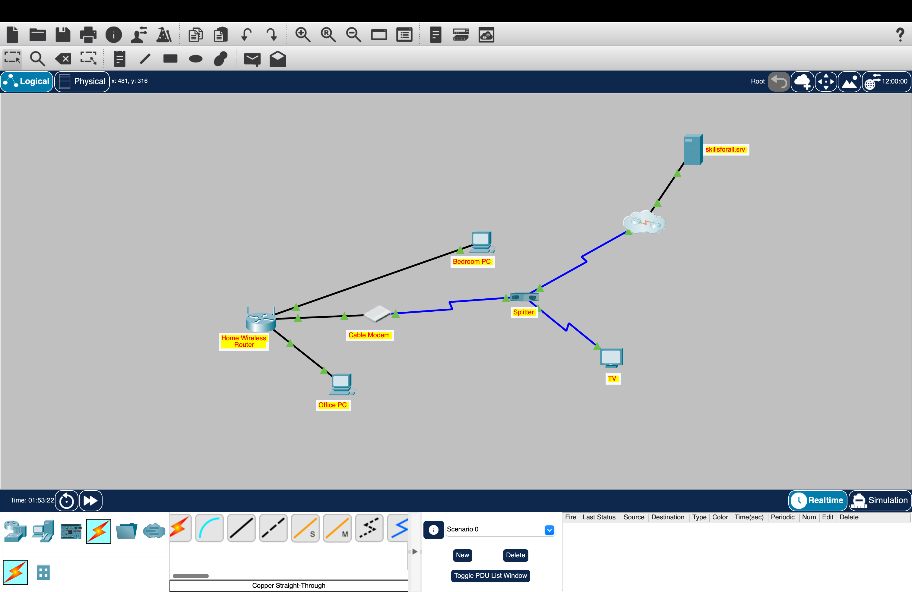
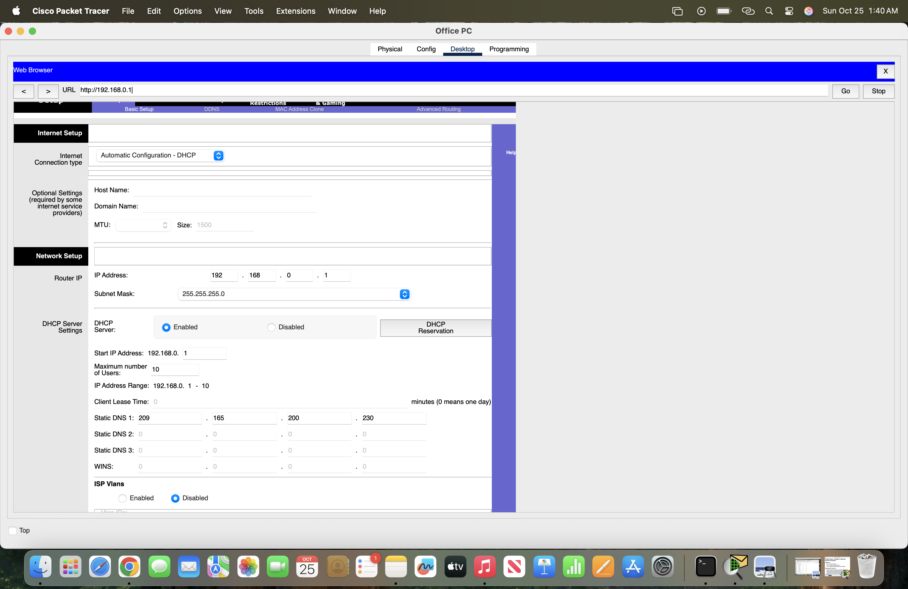
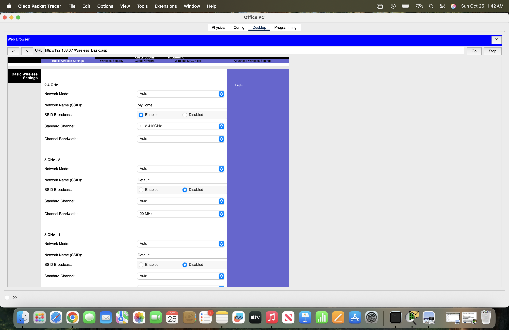
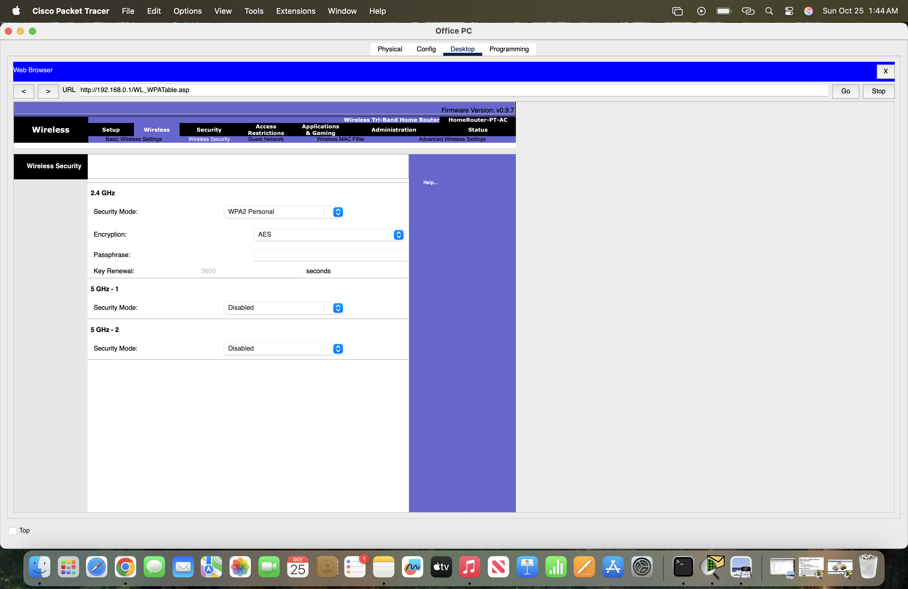
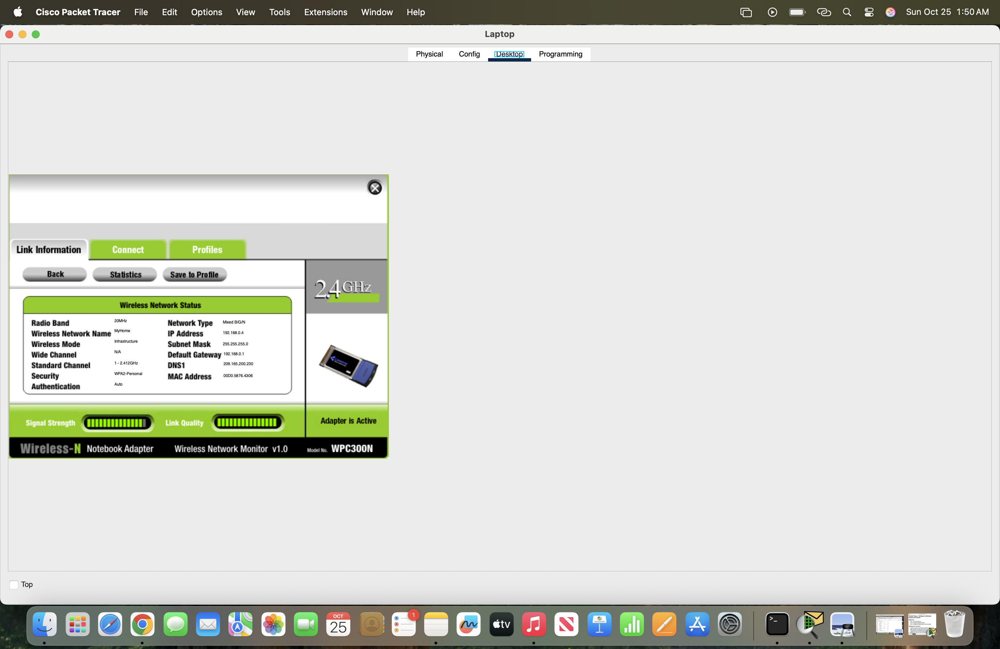
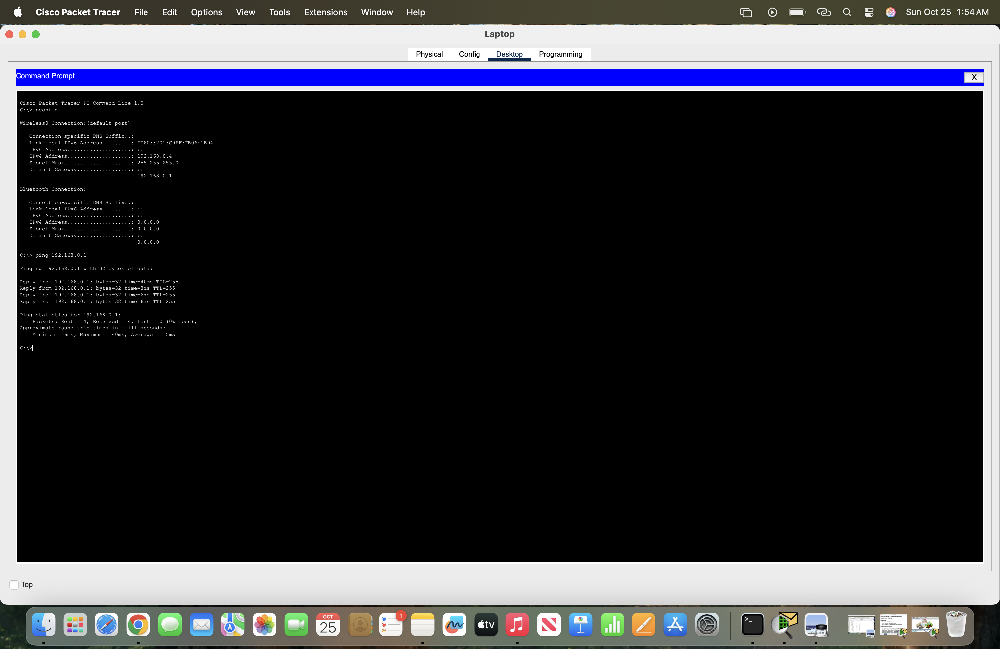

# Cisco Packet Tracer – Wireless Network Configuration

## Project Overview

In this project, I configured and verified a home wireless network using Cisco Packet Tracer.

In the network, a home wireless router is connected to an ISP network through a cable modem. Wired and wireless network connections are enabled.

Wireless LAN configuration, DHCP, IPv4, WPA2 wireless security, DNS, ICMP, and HTTP connectivity testing are all demonstrated in this project.

## Network Topology

The network topology consists of a home wireless router, cable modem, coaxial splitter, wired desktop computers, a wireless laptop, an ISP connection, and an external Skills For All server.

### Network Components

- Home Wireless Router
- Cable Modem
- Coaxial Splitter
- Wireless Laptop
- Bedroom PC
- Office PC
- TV
- ISP Network
- External Skills For All Server

---

## Router and DHCP Configuration

This section of the lab covers the configuration of the home wireless router for local network connectivity and the DHCP server for dynamically providing IPv4 configuration to network clients.

### LAN Configuration

- Router IPv4 Address: 192.168.0.1
- Subnet Mask: 255.255.255.0
- DHCP: Enabled
- DNS Server: 209.165.200.230
- Internet Connection Type: Automatic Configuration – DHCP
  

DHCP automatically configures the IP address, subnet mask, default gateway and DNS servers for all network devices connected to the router.

---

## Wireless Network Configuration

A 2.4 GHz wireless LAN was configured on the home wireless router.

### WLAN Settings

- SSID: MyHome
- Frequency Band: 2.4 GHz
- Wireless Channel: Channel 1 / 2.412 GHz
- SSID Broadcast: Enabled

The SSID is the name of the Wireless LAN that is broadcast by the Home Wireless Router.

---

## Wireless Security

The wireless network was protected using WPA2-Personal with AES encryption.

### Security Configuration

- Security Mode: WPA2-Personal
- Encryption: AES
- Authentication: ***********
- Key Renewal: 3600 seconds

The wireless passphrase has been intentionally excluded from this documentation as a security best practice.

With WPA2-Personal, only authorized clients with the correct password can connect to the WLAN.

---

## Wireless Client Connection

The laptop was configured to connect to the `MyHome` wireless network.

Once connected to the wireless router, the laptop then received its network configuration and established communication on the network.

The wireless client received:

- IPv4 Address: 192.168.0.4
- Subnet Mask: 255.255.255.0
- Default Gateway: 192.168.0.1
- DNS Server: 209.165.200.230

---

## IPv4 Verification

The ipconfig command was used to verify the laptop's Layer 3 network configuration.

The output of the ipconfig command on the laptop shows that the wireless interface has been configured with an IPv4 address of 192.168.0.4/24 and the default gateway is 192.168.0.1.

---

## Local Connectivity Testing

Local network connectivity was tested by sending ICMP echo requests from the wireless laptop to the default gateway.

ping 192.168.0.1

The test returned:

Packets: Sent = 4, Received = 4, Lost = 0 (0% loss)

This verifies successful communication with the home wireless router from the wireless client.

---

## External Connectivity Testing

After verifying local connectivity, the laptop was used to test external connectivity.

The laptop was used to ping:

skillsforall.srv

The DNS resolved the hostname to:

209.165.200.232

The final connectivity test returned:

Packets: Sent = 4, Received = 4, Lost = 0 (0% loss)

This verified successful communication from the wireless client through the home network and ISP infrastructure to an external server.

---

## Application-Layer Verification

HTTP connectivity was tested using the laptop's web browser.

The client successfully accessed:

http://skillsforall.srv

The successful webpage response further verified that application-layer connectivity existed in addition to ICMP connectivity.

---

## Lab Verification

The completed Packet Tracer activity was evaluated using the built-in assessment tool.

### Final Result

**19 / 19 assessment items successfully completed.**

The assessment verified configuration items including:

- DHCP
- Physical connections
- Wireless SSID
- Wireless security
- Encryption
- Wireless authentication
- Client connectivity

---

## Troubleshooting and Verification Process

Network connectivity was verified progressively rather than relying on a single test.

The verification process followed this path:

Wireless Association
        ↓
IPv4 Configuration
        ↓
Default Gateway Connectivity
        ↓
DNS Resolution
        ↓
External Server Connectivity
        ↓
HTTP/Application Connectivity

During initial external connectivity testing, an ICMP request timed out. A subsequent test successfully returned all four responses with 0% packet loss.

This reinforced the importance of repeating connectivity tests and verifying network behavior before assuming that an initial timeout represents a configuration failure.

---

## Skills Demonstrated

This project demonstrates hands-on experience with:

- Cisco Packet Tracer
- TCP/IP
- IPv4 Addressing
- DHCP
- DNS
- Wireless LAN Configuration
- 2.4 GHz Wi-Fi
- WPA2-Personal
- AES Encryption
- Default Gateways
- ICMP
- HTTP
- Network Connectivity Testing
- Command-Line Troubleshooting
- Basic Network Documentation

---

## Key Takeaways

I better understand how wireless clients connect to a home network to reach resources on the internet in this lab.

This project shows how DHCP, IPv4, default gateways, DNS, wireless security, routing, and application-layer protocols are used together to provide connectivity between network devices.

This project also highlighted the importance of validating network configurations at multiple layers in order to be confident in network functionality.

---

## Project Status

**Completed**

Packet Tracer Assessment: **19/19**
